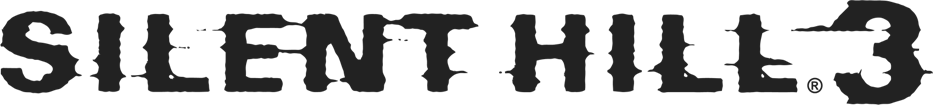
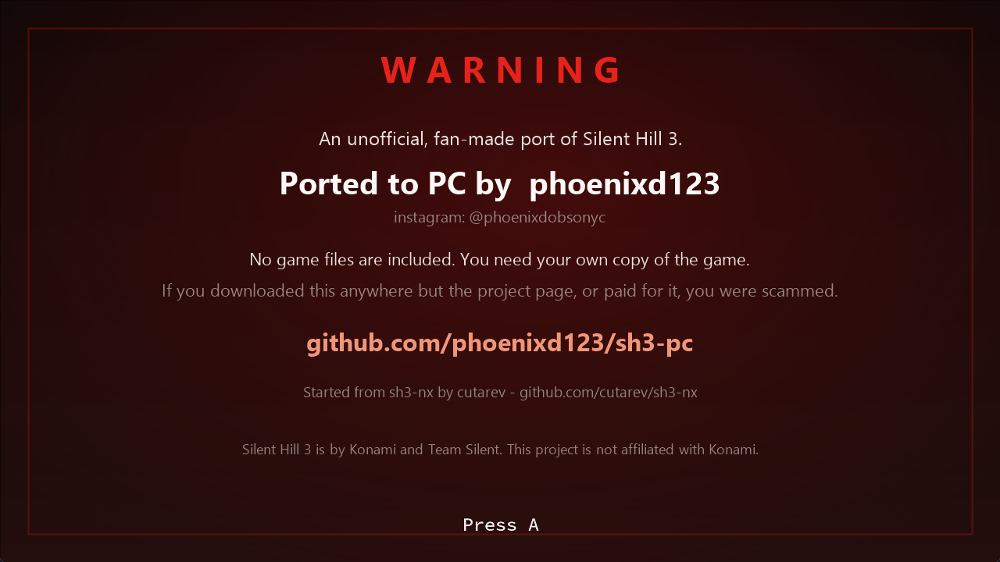
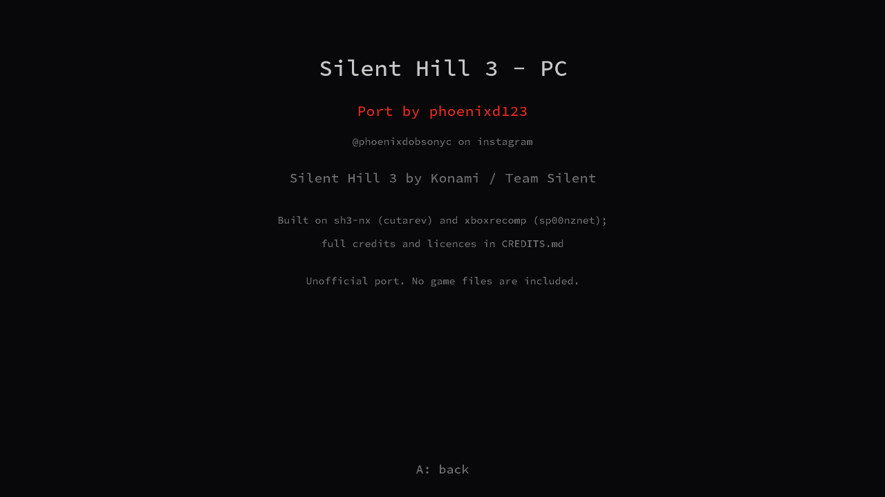

<div align=center>

<picture>
  <source media="(prefers-color-scheme: dark)" srcset="docs/logo.png">
  
</picture>

</div>
<h1 align=center>Silent Hill 3 — PC (and Switch)</h1>

<p align=center><b>1.9.0</b> — ported to PC by <b>phoenixd123</b></p>

A native, statically recompiled port of the PC version of **Silent Hill 3**, for **Windows**, Linux and the
Nintendo Switch. It's not an emulator: the game's x86 executable is recompiled to C ahead of time, and that C is
compiled for the host. The Windows layer the game expects (Direct3D 8, DirectSound, DirectInput, kernel32...) is
reimplemented on top of SDL2 and OpenGL.

<p align=center><b><a href="https://github.com/phoenixd123/sh3-pc/releases/latest">Download the Windows launcher</a></b>
(no build needed). It is the launcher only: the game's code is recompiled from your own <code>sh3.exe</code>, so the full
game is built from your copy, not downloaded — see <a href="docs/BUILD-WINDOWS.md">docs/BUILD-WINDOWS.md</a>.</p>

This is a separate project that started from [sh3-nx](https://github.com/cutarev/sh3-nx) by cutarev, whose work is
most of what makes the game run at all: **who did what is in [CREDITS.md](CREDITS.md)**, and the state of every
known bug is in **[BUGS.md](BUGS.md)**.

> [!NOTE]
> No game files are included. You need your own copy of the PC game, and you build the executable yourself from
> it ([Building](#building)); the recompiler reads your `sh3.exe`.

## Screenshots

<div align="center">

| First launch | Credits |
| --- | --- |
|  |  |

</div>

Both are the port running from a build of this tree: the warning screen every launch starts with, and the credits
roll (on the first launch, and again from the menu).

**There are no gameplay screenshots here yet, because they cannot be made without the game.** Taking one is a
single key: press **F12** in game and the frame it was pressed on is written to `screenshots/sh3-<date>-<time>.png`
in the game folder, at the game's own resolution. That is what belongs in this table � nothing here is a mock-up or
a render of what the port might look like.

## Getting it running on Windows

1. **Your own game.** Silent Hill 3 for PC installed � the 2003 release, `sh3.exe` of 3,338,240 bytes (SHA-1
   `aa2aca6dba19bf510c9c2e92eefdc15e98266581`) and its `data/` folder (about 5 GB). Which executable that is, and
   why the retail disc on its own is not enough, is
   [the next section](#where-the-game-files-come-from).
2. **Build once, from your copy.** There is no binary download: the recompiler turns your `sh3.exe` into C, so a
   build belongs to the copy of the game it was made from. MSYS2, SDL2 and CMake, about 15 minutes:
   [docs/BUILD-WINDOWS.md](docs/BUILD-WINDOWS.md).
3. **Start it.** `build/windows/sh3.exe`, with `SDL2.dll` beside it. The first launch asks for the game folder with
   the usual Windows folder picker; pick the folder that holds `sh3.exe` and `data/`, and the port checks it and
   remembers it in `sh3-pc.ini` beside its own executable, so later launches go straight to the launcher. A path
   argument or `SH3_DIR` answers the question up front, and so does dropping the port's executable into the game
   folder. The path can be the folder, the game's own `sh3.exe`, or a disc: a file dropped on the port is read far
   enough to say what it is, so a PlayStation 2 image and a PC installation disc each come back named, with what to
   do instead; a PS2 image is offered to PCSX2 when the emulator is installed.
4. **Mods are optional**: a `mods/` folder beside the game, with HD texture packs in it ([MODDING.md](MODDING.md)).
5. **Screenshots**: **F12** in game writes `screenshots/sh3-<date>-<time>.png`.

## Where the game files come from

Silent Hill 3 for PC was never sold digitally. In 2003 it shipped on **five CDs in North America** and on **one
DVD in Europe**, installed about 5 GB into a folder you chose, and checked that the disc was in the drive every
time it started (SecuROM 4.85). The installer's **Movies** option is the FMVs: leave it checked, or `data/movie/`
stays empty.

None of that runs here. The port reads the executable as a file, recompiles its functions and supplies its own
Windows layer, so at run time there is **no disc check, no SecuROM, no installer and no optical drive**.

What it does need is the *unprotected* executable, which is why the size and SHA-1 above are pinned:

- the retail `sh3.exe` is wrapped � part of its code is encrypted in the file and only becomes the code the game
  executes after SecuROM's loader has decrypted it;
- a static recompiler translates the bytes in the file. Given the wrapped executable it translates the wrapper,
  not the game.

So the executable to point at is the one the game actually runs as � the same one the community's no-CD/fixed
executables are. Install from your disc (or a backup image of it), then use the executable that belongs to that
install. If `sh3.exe` is a different size the port says so in the log instead of pretending: a build made from a
different executable will crash, not run.

**The PlayStation 2 release cannot be used.** It is a MIPS binary with its own data formats and no Win32 layer to
reimplement; this port is a recompilation of the PC build, and doing the PS2 version would be a different project
from the ground up. Point the launcher at a PS2 image and it says exactly that, naming the program the disc boots
(`SLUS_206.22` on the NTSC disc), instead of failing silently. If PCSX2 is installed, the same dialog offers to
open the image there, which is how the PS2 release is played on a PC; a `.cue` hands over the `.bin` it names.

**A pre-installed rip is the quickest source.** **Options > Import the game download** takes the Full-Rip zip
that abandonware sites host, unpacks it beside itself (Windows' own `tar.exe`, in its own console) and makes the
folder inside that holds `sh3.exe` and `data/` the game; dropping the zip on the port does the same, and a zip
without `sh3.exe` is still treated as a mod. Importing is only the unpack: the game code still has to be
recompiled from that copy, as `docs/BUILD-WINDOWS.md` does, and the 2003 game is still Konami's. In the
launcher-only build, **Play** then offers to start that copy's own `sh3.exe` (the download's NoCD executable),
which is how the imported download runs without a recompiled build; a full build runs the port instead.

## Features

- **Native code**: every function of `sh3.exe` runs as native code for the machine you build it on — x86-64 on PC, ARM64 on the Switch. No emulator, no Wine.
- **Launcher**: it asks for the game folder once and remembers it, then Play and Options before the game; Options changes the resolution and the game threads in `sh3.ini`
  on the console, and on Windows its **Game folder** and **Game disc or file** rows point the port at another
  install: the folder browser takes the install folder, the open-file dialog takes `sh3.exe` or a disc image.
- **Mods in one click**: Options > **Install a mod** takes a `.zip`, unpacks it into `mods/` under the game folder
  and loads it without a restart; dropping the archive on the executable installs it and starts the game. The layout
  is worked out from the archive itself: a `files/` folder, a wrapper folder, or loose `data/...`.
- **Check for updates**: the launcher asks GitHub for this port's newest release and, when there is one, offers it
  when it starts; **Check for updates** in the menu asks by hand. A downloads it, puts the new launcher in place and
  starts it again ([Updates](#updates)). **Options > Auto update** turns the start-up check off.
- **Widescreen**, with a switch: 16:9 at 1280x720 by default, 1920x1080 for docked play, or the original 4:3
  (`widescreen=0` in `sh3.ini`, or Options > Widescreen). ThirteenAG's WidescreenFix, ported. The camera widens in gameplay, cutscenes keep their framing without the
  letterbox, and menus and HUD stay in a centered 4:3 area.
- **Controller**: Nintendo's layout (A confirms, B cancels), remappable in Options > Button Config.
- **Shader cache**: shaders are compiled once and kept on the SD card, so areas only stutter the first time.
- Also builds for Linux (x86-64), which is where most of the debugging happens, and for **Windows** x86-64
  ([docs/BUILD-WINDOWS.md](docs/BUILD-WINDOWS.md)).
- **Mods**: a `mods/` folder next to the game, with loose-file overrides for any file the game reads and **HD
  texture packs** ([MODDING.md](MODDING.md)). No game content ships with them; a pack is built from your own copy
  with `tools/make_hd_pack.py`.
- **Freecam**: **F1** holds the game's clock and detaches the camera, with mouse and WASD movement, a
  wheel-driven field of view, and frame-by-frame stepping to pose a model ([Freecam](#freecam)).
- **PS2-exclusive costumes, from your own copy**: `tools/ps2_outfits.py` appends models you convert from your own
  PS2 disc to copies of `chrpl.arc` and `arc.arc` and writes them as a mod folder, and `patches/*.patch` carries
  the executable's outfit tables into the build ([MODDING.md](MODDING.md)). Nothing from the game ships here.
- **Anisotropic filtering** (`aniso=` in `sh3.ini`), which is also what keeps an HD texture sharp at grazing
  angles.

## What this fork adds to sh3-nx

- **Windows build.** The recompiled code is portable C, so the Switch's ARM64 build and the PC's x86-64 build run
  the same functions. What was missing was the platform layer: `src/runtime/host.c` now has a Win32 thread, arena,
  crash-handler and backtrace backend, `src/runtime/win_posix.c` supplies the locks, clock and folder listing, and
  three PE-COFF problems are fixed (`__start_/__stop_` bridge sections, the launcher's `.incbin` assets, and
  `WINAPI`/`APIENTRY` colliding with the SDK's macros). See [docs/BUILD-WINDOWS.md](docs/BUILD-WINDOWS.md).
- **Mods.** `mods/<name>/files/...` replaces any file the game opens for reading; `mods/<name>/textures/<key>.png`
  replaces a texture at its own resolution with a generated mip chain. `mods/load_order.txt` and `mod.ini`
  (`name=`, `enabled=`, `priority=`) control the order, first match wins.
- **Texture packs.** `texdump=1` (or `SH3_TEXDUMP`) writes every texture the game uploads as
  `texdump/<key>.png`; `tools/make_hd_pack.py` upscales them into a mod. Textures are keyed by a hash of the
  pixels the game uploads, because the game reads `.tex` archives by offset and no name reaches the renderer.
- **Anisotropic filtering** and mip filtering for stages that asked for none (`aniso=`, default 8, `1` = off): a
  texture with a single level samples exactly as before, an HD one keeps its detail.

Still open from the list below: the FMVs, the black screen after the Office Building bathroom, and the stretched
logos and credits. Those are unchanged here; the texture and mod work does not touch them.

## Upstream history

The releases below are sh3-nx's, kept for reference; each one is in this tree.

### v0.06

- **Launcher**: after a warning screen, Play and Options come before the game, with the game's own menu sounds.
  Options sets the resolution (720p, 1080p or the original 4:3) and the game threads, and writes them to `sh3.ini`
  (see [Settings](#settings)).
- Pause menu: the black box behind it is gone, so the game stays visible behind the menu text.
- Pause menu: Save and Load were greyed out when the game was paused during a fade-in (back from the save screen,
  after a load or a door) until the menu was reopened.
- Fixed large triangles drawn over the car windows in the cutscene after the Missionary fight
  ([#6](https://github.com/cutarev/sh3-nx/pull/6), by [Ligux01](https://github.com/Ligux01)): where two paths
  joined, the recompiler read the zero flag back from a register that had been overwritten since, so some
  triangles got the wrong winding. It now uses the saved flag, with regression tests in the lifter.

### v0.05

- ZL and ZR swapped to match sh2-nx: ZL is the search view, ZR readies the weapon (see [Controls](#controls)).

### v0.04

- Controls laid out as in sh2-nx: L / R strafe, ZL is the search view, ZR readies the weapon (see
  [Controls](#controls)).
- Fixed a crash breaking the white rubble wall with the silencer in the construction site (a callback that was
  only partly recompiled; nine others like it fixed too).

### v0.03

- Better crash logs: `sh3-crash.log` lists the last calls of the thread that crashed (they were mixed from every
  thread), and with `log=1` in `sh3.ini`, `sh3.log` names any file the game fails to open.
- Fixed a crash entering the area past the Hazel Street station stairs (a monster callback that was never
  recompiled; another one like it fixed too).

### v0.02

- Heather's hair in the real-time cutscenes was drawn as solid blocks
  ([#1](https://github.com/cutarev/sh3-nx/issues/1)): the alpha of the game's paletted (P8) textures was dropped
  when they were expanded for OpenGL. The palette's alpha is now honored, and palettes are handled as Direct3D 8
  does (numbers up to 65535, a texture expanded again when its palette changes).

### v0.01

The first release: from the title screen into the game, with New Game, the opening, gameplay, the pause menu,
inventory, options and Button Config.

Known issues:

- The FMVs (`data/movie/*.000`, played through DirectShow on PC) are skipped.
- After the cutscene in the Office Building bathroom the screen can stay black: press a button to continue.
- The Konami and KCET logos and the credits are stretched on a wide screen.
- Little tested past the first areas: if it crashes, `sh3-crash.log` next to the NRO says where (please attach it
  to an issue).

## How to install on the Switch

1. Install Silent Hill 3 on your PC. The port is built for the `sh3.exe` of 3,338,240 bytes, SHA-1
   `aa2aca6dba19bf510c9c2e92eefdc15e98266581`.
2. Copy to the SD card, with the card (or its folder) mounted on the PC:

   ```sh
   .venv/bin/python tools/make_sd.py /path/to/sd      # from a clone of this repository
   ```

   or by hand. Your `sh3-pc` folder should look like this:

   ```text
   /switch/sh3-pc/
     sh3-pc.nro       (the built NRO)
     sh3.exe          (from your PC install)
     data/            (from your PC install, about 5 GB)
     savedata/        (an empty folder: saves and settings go here)
     sh3.ini          (optional, see Settings)
   ```

3. Launch it from the homebrew menu in **title takeover** mode (hold **R** while starting an installed game). Not
   from the album: applet mode does not give homebrew enough memory.

Saves, settings and the shader cache are written next to the NRO.

> [!CAUTION]
> The first time you enter an area its shaders are compiled, so **it can stutter for a moment**. They are kept in
> `sh3-progs.bin` and later visits are smooth.

## Controls

<div align="center">

| Switch | Xbox (PC) | Action |
| --- | --- | --- |
| A | A | Action, confirm |
| B | B | Flashlight, cancel |
| Y | X | Dash |
| X | Y | Map |
| L / R | LB / RB | Strafe left / right |
| ZL | LT | Search view |
| ZR | RT | Ready weapon |
| + | Start | Inventory |
| − | Back | Pause, skip |
| Left stick, d-pad | Left stick, d-pad | Move |
| Right stick | Right stick | Camera |
| L stick click | LS | Supplies |
| R stick click | RS | Zoom |

</div>

Laid out as in sh2-nx; change them in Options > Button Config. A `savedata/key.ini` saved by an older version keeps
its old layout: delete it to get this one. With a keyboard on PC: W A S D and Q E
to move and turn, Space for action, Return / Escape to confirm / cancel.

## Freecam

**F1** in game detaches the camera from the game's own and holds the game's clock, so the frame stands still
while you move around it; **F1** again returns to the game. The scene is still drawn by the game every frame,
which is why the camera moves smoothly and the HUD and cutscene framing stay right.

| Key | Action |
| --- | --- |
| W A S D | move, along the way the camera looks |
| Q / E | down / up |
| Shift / Ctrl | four times faster / four times slower |
| mouse | look |
| wheel | field of view, 0.25x to 4x |
| `,` `.` | step the held clock back / forward one frame |
| `[` `]` | step ten frames |

Stepping is what poses a model: each step advances every animation by exactly one frame of the game's 30 Hz, so
a walk, an idle or a cutscene can be left on a chosen frame and photographed from any angle. It is frame by
frame rather than by named keyframes, because an animation's keyframe table lives in model data the render layer
never sees.

The clock is what stops, not the threads: the game keeps rendering, so nothing has to be suspended and the
window stays responsive. A game that waits for its clock before drawing the next frame is the one case that
would hang, so after 400 ms without a frame the port lets one frame through and says so in the log; there the
freeze becomes a slow advance instead of a deadlock.

It moves the render camera, not the game's: the game still culls what its own camera cannot see, so a view
pushed far from it can leave geometry out, and the near and far planes stay the game's.

## Camera

**F2** cycles the camera between off, an **over the shoulder** view and a **first person** view, and
`camera=ots` or `camera=first` in `sh3.ini` starts the game with one. The view is moved along the axes the
game's own camera looks along: the scene is drawn from a point closer to Heather, while collision, aiming,
the game's culling and the menus stay where the game put them, so this is a camera, not a new game mode.
An object between the game's camera and the moved eye is still drawn, because the game drew it.

| Mode | `camera=` | forward | right | up |
| --- | --- | --- | --- | --- |
| off | `off` (or `0`) | 0 | 0 | 0 |
| over the shoulder | `ots` (or `1`) | 1.10 | 0.45 | 0.10 |
| first person | `first` (or `2`) | 2.20 | 0.00 | 0.20 |

The distances are in the game's units, along the view's forward, right and up; `cam_forward=`, `cam_right=`
and `cam_up=` in `sh3.ini` replace the preset's, which is what to do when the camera sits inside Heather or
too far behind her for the area being played.

While a camera mode is on, **Alt** with the **arrow keys** and **Page Up / Page Down** move the eye a step at a
time (0.05; hold **Shift** for 0.25): Up / Down are forward, Left / Right are right, Page Up / Page Down are up.
Each step logs the three numbers in the form to paste, so a distance found by looking can go straight into
`sh3.ini`:

```
camera: sh3.ini  cam_forward=2.35  cam_right=0.45  cam_up=0.20
```

**F2** starts again from the presets and forgets the nudges; the first nudge after it continues from the
preset the mode was showing.

## Settings

`sh3.ini`, next to the NRO (every line is optional); the launcher's Options screen sets `resolution` and `cores`:

| Setting | Effect |
| --- | --- |
| `resolution=1280x720` | the default; `1920x1080` for docked play, `960x720` or `640x480` for the original 4:3 |
| `cores=1` | every game thread on one core, a fallback if the audio misbehaves |
| `log=1` | also write `sh3.log` next to the executable, for bug reports (off by default on the Switch, where it costs an SD card write per line). Crashes always go to `sh3-crash.log` |
| `trace=1` | with `log=1`, log every Windows call the game makes (very slow) |
| `hd=1` | read HD texture packs from `mods/` (the default); `hd=0` uses the game's own textures |
| `aniso=8` | anisotropic filtering, 1-16 (default 8, `1` = off) |
| `widescreen=1` | the 16:9 framing (default); `0` restores the original 4:3 camera, menus and cutscene borders |
| `filter=0` | a look over the whole frame: `0` off, `1` CRT (scanlines, warm tube, darker corners), `2` VHS (colour bleed, grain, slow roll) |
| `texdump=1` | write every texture the game uploads to `texdump/`, for making a pack |
| `autoupdate=1` | the launcher checks GitHub for a newer release when it starts (default; `0` only answers **Check for updates** in the menu). Windows only |

The port keeps one file of its own beside its executable: `sh3-pc.ini`, holding `game=`, the folder the launcher
was pointed at. **Options > Game folder** picks it again with the Windows folder dialog, starting where it is now,
and **Options > Game disc or file** takes the game's own `sh3.exe` or a disc image through the open-file dialog;
anything that is not the game is refused with the same words the command line uses, and nothing is written. In game, **F12** writes `screenshots/sh3-<date>-<time>.png` next to `sh3.exe`.

### Mods

The launcher has a Mods screen: **Mods** in its menu, or press **M** anywhere in it. The left column is what is
installed from `mods/`; the right column is the newest Silent Hill 3 mods, straight from the official API
(`api.nexusmods.com`, `latest_added.json` - the endpoint that replaced the old all-mods list in 2025) - nothing
is scraped, which the site's terms forbid.

To see the list, put your own personal API key (nexusmods.com, **API Access**) into `sh3.ini`:

```ini
nexus_key=your-key-here
```

The key stays on your machine; it is not part of the repository, and `SH3_NEXUS_KEY` in the environment does the
same thing for a test run.

- **A** downloads the selected mod's main file and installs it into `mods/`, in the background, with progress on
  the screen. This uses the API's download endpoint, which Nexus only allows for **Premium** accounts: a free key
  can list mods but gets 403 for the file. When that happens the launcher says so and offers the page instead.
- **N** opens the selected mod's page, which is the way to download it without Premium: download the file there,
  then drop the `.zip` on the launcher window and it is installed into `mods/` like any other mod.
- **R** asks Nexus for the list again, **B** goes back. A `.zip` dropped on the window works from any screen.

The same installer as before handles both routes: a zip is unpacked into `mods/<name>/`, its shape is worked out
(`files/`, or `mod.ini` as it stands), and the game picks it up on the next start.

### Updates

The launcher updates itself from this repository's releases. It asks `api.github.com` for the newest release of
`phoenixd123/sh3-pc` - no key and no account - and compares its tag with the version the launcher was built as.

- **At start-up**, when `autoupdate=1` (the default), the check runs in the background while the warning screen is
  up. A newer release opens the **Updates** screen once: **A** downloads and installs it, **B** plays this version.
- **Check for updates** in the menu asks again at any time and shows what it found, including the error when there
  is no connection.
- Installing downloads the release's `sh3-pc-launcher-<version>-win64.zip`, unpacks its `sh3-pc-launcher.exe`,
  `SDL2.dll` and `README.txt` into `%TEMP%\sh3-pc-update`, and writes a small script that copies them beside the
  launcher once the process has ended - Windows locks a running `.exe` and its DLLs - then starts the launcher
  again. Only those files are written: `sh3.ini`, `sh3-pc.ini`, `savedata/` and `mods/` are left alone.
- A build made from source (named `sh3.exe`) is told that it is updated by rebuilding, and the screen offers
  nothing to install: the release is the launcher, not a build of your copy.

For a test run, `SH3_UPDATE_API` points the check at another address (a local stand-in is in
`build/mock_update.py`) and `SH3_UPDATE_DRYRUN=1` writes the install script without starting it.

## Building

You need the game (step 1 of [Getting it running on Windows](#getting-it-running-on-windows)): the code generator
reads `sh3.exe`, applies the
widescreen patches to it and recompiles it. Windows has its own page: [docs/BUILD-WINDOWS.md](docs/BUILD-WINDOWS.md).

Requirements: Python 3, CMake, Ninja, and for the Switch build podman (or a local devkitPro install with devkitA64,
libnx, switch-sdl2 and switch-mesa). For the Linux build, the SDL2 development files.

```sh
git clone https://github.com/phoenixd123/sh3-pc && cd sh3-pc   # or your fork
python3 -m venv .venv && .venv/bin/pip install -r requirements.txt
ln -s "/path/to/Silent Hill 3" game     # the folder holding sh3.exe and data/
tools/regen.sh                          # recompiles game/sh3.exe into src/recomp/gen (~5 min)

tools/build-switch.sh                   # -> build/switch/sh3-pc.nro (devkitPro's container under podman)
tools/build-switch-local.sh             # the same with a local devkitPro install

cmake -S . -B build/linux -G Ninja && cmake --build build/linux    # Linux build
build/linux/sh3 game
```

On Windows the same CMake build works with MSYS2's mingw-w64 toolchain and SDL2; the details, and what the
Windows layer does differently, are in [docs/BUILD-WINDOWS.md](docs/BUILD-WINDOWS.md).

### Steam Deck

The Deck plays Windows games through Proton, and this launcher is a Windows program, so **the release zip is the
Deck build**: no separate download. There is no native Linux build of the launcher - the game it starts is a
Windows executable anyway, and Proton is how that runs.

1. In Desktop Mode, copy `sh3-pc-launcher-1.8.0-win64.zip` and your Full-Rip zip to the Deck, e.g.
   `~/Games/Silent Hill 3/`. Unzip the launcher there.
2. Steam -> **Games -> Add a Non-Steam Game** -> browse to `sh3-pc-launcher.exe`.
3. Right-click it -> **Properties -> Compatibility** -> force **Proton Experimental** (or Proton GE).
4. Launch it from Game Mode. **Options -> Import the download**, pick the Full-Rip zip, then **Play**.

Two things used to break under Proton and no longer do:

- **Importing the zip** needed Windows' `tar.exe`, which a Proton prefix does not have. The archive is now read by
  the launcher itself, so Import works on the Deck exactly as it does on Windows.
- **"The game is not installed properly"**: the install entry is written straight into the Proton prefix (its
  HKLM is the prefix's own registry), so there is no permission prompt and no manual `.reg` on the Deck.

Controls in the launcher: **A** picks, **B** goes back, the D-pad or left stick moves, **Start** also picks. The
window is 1280x720, so a 1280x800 Deck screen shows thin bars top and bottom. Widescreen and the CRT/VHS filters
are in Options; the fog settings behind the burning hallway belong to the game's own executable, not to a
launcher.

The release zip is still the **Windows launcher only** - it contains no game code. The recompiled port in
`src/` also builds natively on Linux (`cmake -S . -B build/linux -G Ninja`), but nothing here has been run on a
Deck or under Proton, and there is no prebuilt Linux launcher.

To make a mod, see [MODDING.md](MODDING.md).

## How it works

- **The game's code is translated, not emulated.** `tools/regen.sh` wraps the PE as an XBE for
  [xboxrecomp](https://github.com/sp00nznet/xboxrecomp) (patched for these ports), which turns every function into C.
  `tools/seeds.py` finds the functions only data refers to, `tools/fix_functions.py` repairs the ones the
  disassembler cut short, and `tools/observed_seeds.txt` lists those found at run time.
- **Widescreen.** ThirteenAG's fix patches the running game; here its code changes are byte patches applied to the
  exe before recompiling (`tools/patch_exe.py`, each site checked against the original bytes) and hand-written
  functions in `src/game/sh3.c`.
- **The Windows layer.** Direct3D 8 runs on OpenGL with the shaders translated to GLSL (`src/d3d8`), DirectSound is
  a software mixer on SDL audio, DirectInput goes through SDL, and kernel32, user32 and winmm are in `src/win32`.
  `src/runtime` holds the guest memory, threads and the Linux/Horizon/Windows layer.
- **Mods.** `src/mods` scans `mods/`, answers file opens with a mod's copy when one exists (the Win32 file bridge
  asks it before touching `data/`), and replaces an uploaded texture when a pack has its key. PNGs are read with
  stb_image; the key is an FNV-1a over the level-0 pixels, format and size (and the palette, for P8).

## Debugging aids (Linux)

| Variable | Effect |
| --- | --- |
| `SH3_KEYS="22:Return,30:Down+2"` | scripted key presses (seconds, key, optional hold); the window is hidden and the real keyboard ignored |
| `SH3_SHOW=1` | keep the window visible during a scripted run |
| `SH3_SHOT=dir`, `SH3_SHOT_EVERY=n` | dump frames as PPM (`tools/ppm2png.py`) |
| `SH3_STATS=1` | frame rate and guest heap |
| `SH3_TRACE=1` | log every bridged Windows call |
| `SH3_PEEK=va,...` / `SH3_POKE=frame:va=value` | log guest dwords every 60 frames / write one |
| `SH3_COVER=frame` / `-frame` | with a tracing build (`TRACE=$PWD/build/disasm/functions.json tools/regen.sh --recomp-only`), log the functions that run after that frame |
| `SH3_ORACLE=va,n` | differential test of one function against Unicorn (`tools/oracle.py`) |

A build with `-DRECOMP_ABI_CHECK` logs every call that returns with `esp`, `ebx`, `esi` or `edi` changed, on the
Switch too (`log=1`). `tools/fuzz.py` checks the lifter's instruction semantics against Unicorn.

## Credits

The full list is [CREDITS.md](CREDITS.md). This port is by **phoenixd123** (@phoenixdobsonyc on Instagram); it
started from **sh3-nx by cutarev**, and
the rest of what it stands on — xboxrecomp, sh2-nx, ThirteenAG's widescreen fix, stb, devkitPro, SDL2, Mesa — is
credited there.

- **Konami and Team Silent**: creators of Silent Hill 3. This is an unofficial, fan-made port with no affiliation.
- **[WidescreenFixesPack](https://github.com/ThirteenAG/WidescreenFixesPack)** by ThirteenAG (MIT): the widescreen
  fix.
- **[sh2-nx](https://github.com/cutarev/sh2-nx)**: the runtime this port starts from.
- **[xboxrecomp](https://github.com/sp00nznet/xboxrecomp)** by sp00nznet: the x86 to C lifter.
- **nfsmw-nx**, the Need for Speed: Most Wanted Switch port, for the Horizon guest-memory technique.
- **[devkitPro](https://devkitpro.org) and [switchbrew](https://github.com/switchbrew/libnx)**, SDL2, Mesa.
- **[stb](https://github.com/nothings/stb)** (public domain): `stb_image` and `stb_image_write`, for the mod
  system's PNGs.

## Legal

Silent Hill is a trademark of Konami. This project is not affiliated with Konami. This repository contains no assets
or program code from the original game; users must provide their own copy. Running homebrew requires custom firmware.

The port's own code is MIT ([LICENSE](LICENSE)). `third_party/xboxrecomp` is LGPL-2.1 and keeps its own licence
there, and the widescreen patches come from ThirteenAG's MIT-licensed WidescreenFixesPack; nothing here grants any
right to the game itself.
